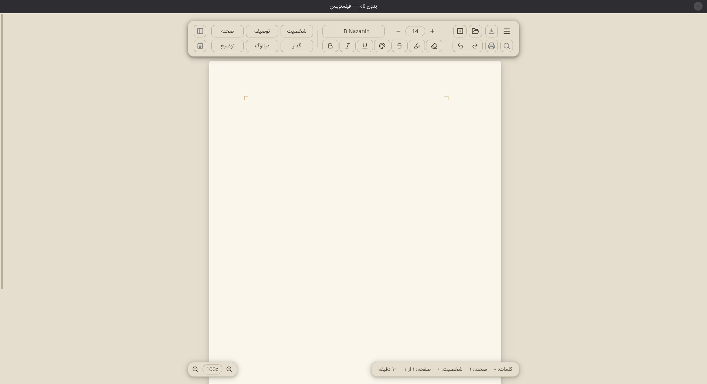

# Filmnevis 🎬
**An open-source, RTL-first screenwriting editor built for Persian writers.**

[](https://www.python.org/)
[](https://doc.qt.io/qtforpython-6/)
[](https://www.gnu.org/licenses/gpl-3.0)

> **🚧 Status: Active Development.** 
> The **Final Version** is currently in development. The codebase is being rewritten from scratch to solve the architectural challenges found in early prototypes. An official release with downloadable binaries will be published in the near future.



## 📖 The Vision
Filmnevis aims to be a native, free, and open-source alternative to industry standards like Final Draft, specifically tailored for Persian language and Right-to-Left (RTL) typography. It focuses on a distraction-free writing experience, standard screenplay formatting (Scene, Action, Character, Dialogue, etc.), and true pagination.

## 🔬 Project Evolution & R&D Archive
Building a rich-text screenwriting editor is a complex engineering challenge. Before arriving at the current architecture, this project went through extensive research and development (R&D). 

The [`/archive`](./archive) directory in this repository contains two early prototypes. While they are not production-ready and were ultimately abandoned, they serve as valuable case studies in UI framework limitations for rich-text block formatting:

1. **GTK4 Prototype:** An attempt to use GTK4's `Gtk.TextBuffer`. It was abandoned due to severe performance issues and inherent limitations in handling complex block margins (Dialogue vs. Action) without relying on hacky workarounds.
2. **Qt Prototype:** A major architectural leap forward using PySide6 and `QTextDocument`. It proved that Qt is the right tool for this job. However, it was archived because implementing *true pagination* (text flowing to the next physical A4 page) and optimizing performance for large scripts proved to be too complex for that specific codebase design.

*You can read the full technical post-mortem of these prototypes in the [`archive/README.md`](./archive/README.md).*

## ✨ Features (Planned for Final Version)
- [x] **RTL Native:** First-class support for Persian text direction and typography.
- [x] **Standard Formatting:** Smart handling of standard elements (Scene Heading, Action, Character, Parenthetical, Dialogue, Transition).
- [x] **Smart Shortcuts:** `Ctrl+1..6` for quick element switching and intelligent `Enter` flow.
- [x] **Custom A4 Pagination:** True page breaks that mimic real physical pages.
- [ ] **Export Options:** Export to PDF and standard formats (Coming soon).
- [ ] **Focus Mode:** Distraction-free writing environment.

## 🤝 Contributing
This project is in its early stages. Contributions, bug reports, and feature requests are welcome! Feel free to open an issue or submit a pull request.

---
## 🚀 How to Run (Archived Prototypes)
If you are interested in exploring the early R&D phases, you can run the Qt prototype locally (Note: Running the GTK prototype requires PyGObject to be installed on your system):

```bash
# Navigate to the archived Qt prototype directory
cd archive/qt-version

# Install dependencies
pip install -r requirements.txt

# Run the app
python main.py
